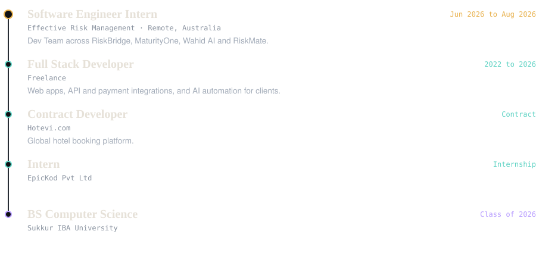
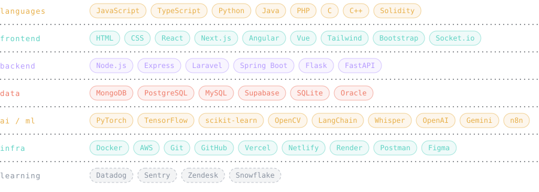

  

  
  
  
  

 

I'm Aamir. I write full stack software, mostly on the MERN stack, and my favourite part of a project is the stretch where a rough idea turns into something people can actually click on.

I finished my CS degree at Sukkur IBA in 2026. Before that I freelanced for a few years, did contract work on a global hotel booking platform, and most recently wrapped up a remote internship with an Australian risk management company, where I worked on four of their products.

Outside client work I do research. A paper I led on IoT intrusion detection was accepted at ApplePies 2026 and will appear in Springer's LNEE proceedings. I'm also a Hafiz-e-Quran, and I like to think the same habits help with code: patience, repetition, and checking your work twice.

 

 

Co-authors are from Sukkur IBA, University of Aveiro, Tallinn University of Technology and University of Genoa. The models are compared within each dataset first, then across them, using a shared 40-feature representation. Interests: IoT security, intrusion detection, feature drift, explainable ML, metric learning.

<!-- When you have them, add research profile badges here:

-->

 

 

  
  

  
  

  
  

  
  

Also built: **LaundryBook** (dorm laundry booking and scheduling), **NoteSwap** (2nd place at Techathon 2025), **FasalDoc** (crop disease detection).

Older projects

 

Mugshot Manager (facial recognition and image management), Legacy Capsule (encrypted digital vault), Grace After 50 (accessible wellness platform), Book Bounty (book recommendations and library system), Global Topup (international recharge payments), SmartOffice Controller (IoT dashboard), TravelX (AI trip planner), and the Lexer project (a compiler for the Tron language).

 

 

  
  

  

  

 

  

