 

  

---

## 🟡 About Me

I'm **Aamir Hussain**, a Computer Science graduate from **Sukkur IBA University (2026)**. I enjoy building full stack applications, exploring artificial intelligence, and turning ideas into practical software.

My main focus is the MERN stack, but I also work across AI/ML, cloud infrastructure, databases, and modern development tools. I enjoy the complete development process, from designing interfaces and building APIs to deployment and integration.

My experience includes freelance software development, contract development for a global hotel booking platform, and a Software Engineering internship with an Australian risk management company.

I also led an IoT intrusion detection research paper accepted at **ApplePies 2026**, with intended publication in Springer's *Lecture Notes in Electrical Engineering (LNEE)*.

Outside technology, I'm a **Hafiz-e-Quran**. I value consistency, patience, and continuous learning.

## 🟢 What I'm Currently Doing

<table>
<tr>
<td width="50%" valign="top">

### 

- Full Stack applications
- AI-powered software products
- Freelance and independent projects
- Practical tools that solve real problems

</td>
<td width="50%" valign="top">

### 

- LLMs and agentic AI
- Observability and monitoring
- Modern data platforms
- International Master's opportunities

</td>
</tr>
</table>

I'm open to Full Stack Engineering and AI Engineering opportunities, freelance projects, and meaningful collaborations.

## 🟣 Research & Publications

### DAX-IDS

**Drift-Aware Explainable Evaluation of Cross-Dataset IoT Intrusion Detection**

Research focused on evaluating machine learning models for IoT intrusion detection across different datasets.

**Research focus:**
- Cross-dataset model evaluation
- Shared 40-feature representation
- Feature drift analysis
- Explainable machine learning
- Metric learning and IoT cybersecurity

**Research collaboration:** Sukkur IBA University, University of Aveiro, Tallinn University of Technology, and University of Genoa.

## 🔵 Professional Journey

| Position | Organization | Period |
|:---|:---|:---:|
| Freelance Software Engineer | Fiverr / Independent | 2023 – Present |
| Software Engineer Intern | Effective Risk Management | 2026 |
| Contract Developer | Hotevi.com | Project-based |
| Full Stack Developer Intern | EpicKod Pvt. Ltd. | 2025 |
| BS Computer Science | Sukkur IBA University | 2022 – 2026 |

## 🟡 Selected Projects

### Featured Work

### A Few Project Highlights

<table>
<tr>
<td width="50%" valign="top">

**E-Parliament System**

Digital transformation of Pakistan's National Assembly with role-based portals, real-time communication, and AI-powered features.

`MERN` `Socket.IO` `Whisper` `Gemini`

<a href="https://e-parliamentsystem.vercel.app/">View Live Project ↗</a>

</td>
<td width="50%" valign="top">

**Veritus**

Business learning platform featuring courses, quizzes, certificates, analytics, coupons, and a marketplace.

`Full Stack Development`

<a href="https://veritus-effectiverm.vercel.app/">View Live Project ↗</a>

</td>
</tr>
<tr>
<td width="50%" valign="top">

**IoT Intrusion Detection**

Research project focused on machine learning evaluation for detecting malicious activity in IoT environments.

`Python` `TensorFlow` `Scikit-learn`

<a href="https://github.com/aamir-786/DAX-IDS">Research Repository ↗</a>

</td>
<td width="50%" valign="top">

**Pneumonia Detection**

Deep learning-based medical image classification project.

`Python` `Deep Learning` `CNN`

</td>
</tr>
</table>

### More Projects

| Project | Description |
|:---|:---|
| ShareNet | Collaborative resource-sharing project |
| Negotio | Negotiation and business workflow project |
| C-Section Symptom Explainer | Accessible symptom explanation application |
| MilepactEscrow Audit | Escrow workflow auditing project |
| LaundryBook | Dormitory laundry booking and scheduling |
| NoteSwap | Academic resource sharing, 2nd place at Techathon 2025 |
| FasalDoc | Crop disease detection |
| Grace After 50 | Accessible wellness platform |
| Mugshot Manager | Facial recognition and image management |
| Legacy Capsule | Encrypted digital vault |
| Book Bounty | Book recommendations and library management |
| Global Topup | International recharge platform |
| SmartOffice Controller | IoT-based office dashboard |
| TravelX | AI-powered trip planner |
| Lexer | Compiler implementation for the Tron language |

## 🟢 Technologies & Tools

### Languages

### Frontend Development

### Backend Development

### Databases & Cloud

### AI / ML & Development Tools

## 🟣 GitHub Analytics

  

  

## 🔵 Let's Connect

### Have an interesting idea or project?

I'm always happy to connect with developers, researchers, founders, and people building meaningful things.

  

  

 

Building, learning, and improving one project at a time.

